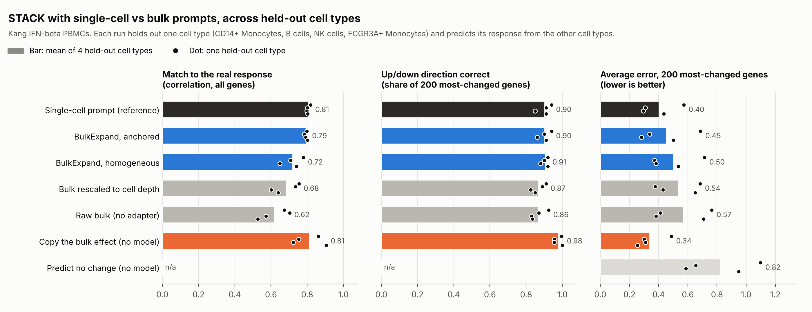

# BulkExpand: using bulk RNA-seq as reference perturbations in STACK

*Fork branch `sohum/bulk-expand` (PUBS x Engram, fall 2026). Add-on; the STACK checkpoint is not retrained.*

## The problem

STACK learns a perturbation in context: you show it prompt cells (untreated and treated, in some reference
context) and it predicts how query cells respond. Those prompt cells must be human single-cell RNA-seq.
Most perturbation screens are bulk RNA-seq, which is cheaper and covers far more drugs, doses and
timepoints, so STACK cannot use most of the references that exist.

## Why bulk breaks STACK (from the code)

1. **No depth normalization on the way in.** STACK takes raw UMI counts and applies `log1p` directly
   (`models/core/base.py`, `models/core/inference.py`). The decoder scales its output by each input cell's
   library size. A bulk sample has about 10^6 to 10^7 reads, versus about 10^3 for a cell, so its input values
   are far outside anything STACK saw in training.
2. **No zeros.** A single cell is mostly zeros (96.5% in Kang). A bulk profile is dense.
3. **No cell-to-cell structure.** Each layer attends *across the cells of the set* (`gene_attn` in
   `modules/attention.py`; the names are swapped, and `cell_attn` is the within-cell step). A bulk sample is
   one averaged vector, so there is no population for that attention to read.
4. **Different count biases.** Full-length bulk RNA-seq reads scale with transcript length; 3' UMI counts
   do not.

## The method

`stack.bulk` converts bulk reference perturbations into synthetic prompt cells that look statistically
like real single cells, then hands them to the unmodified `stack-generation`.

**Anchored mode (recommended).** Inputs: bulk counts for control and treated samples of the reference
context, plus an *unperturbed* single-cell atlas of that context. Unperturbed atlases exist for far more
contexts than perturbation screens do.

1. Bulk fold change per gene: `FC = (treated CPM + 1) / (control CPM + 1)`, optionally one per bulk
   replicate, clipped to [1/32, 32]. Because it is a ratio of two bulk samples, transcript-length and
   library-prep biases shared by both samples cancel.
2. For each synthetic cell, pick a real atlas cell and estimate its underlying expression by averaging it
   with its 15 nearest neighbours (PCA on log-normalized highly variable genes). This gives non-zero
   expected values, so the fold change also applies to genes that happened to have 0 counts in that cell.
3. Multiply by the bulk fold change, renormalize, mix in 2% of the population-level target, and draw
   Poisson UMI counts at the anchor cell's own sequencing depth.
4. Control prompt cells go through exactly the same smoothing and resampling with FC = 1. So the only
   systematic difference between the control and treated prompts is the bulk-measured effect; smoothing
   and resampling artifacts cancel.

**Homogeneous mode (fallback, no atlas).** Draw cells straight from the bulk profile with single-cell
library sizes and negative-binomial noise. This fixes depth and sparsity but has no real cell-to-cell structure.

## Usage

```bash
pip install -e .   # registers stack-bulk-prompt
stack-bulk-prompt --bulk bulk_counts.tsv --design design.csv --control DMSO \
    --atlas unperturbed_cells.h5ad --out prompt.h5ad          # add --gene-lengths for homogeneous mode
stack-generation --checkpoint bc_large_aligned.ckpt --genelist basecount_1000per_15000max.pkl \
    --base-adata prompt.h5ad --split-column condition --test-adata query.h5ad --output-dir out/
```

The bulk table can have genes in rows (GEO style) or columns. `design.csv` has columns `sample,condition`.
Python API: `stack.bulk.expand_anchored(atlas, bulk_counts, conditions, control)` and `expand_homogeneous(...)`.

## Evidence

### 1. The synthetic cells look like real cells (no STACK involved)

`examples/bulk/validate_prompts_kang.py`. Kang et al. 2018 IFN-beta PBMCs; reference context = all cell types
except CD14+ monocytes; bulk = per-donor pseudobulk of those cells (8 donors x 2 conditions).

| Prompt | Median depth | Zeros | Effect vs real cells, r (top-200 genes) | Direction correct (top-200) | Classifier can tell from real cells (AUC; 0.5 = cannot) |
|---|---|---|---|---|---|
| Real single cells | 1,148 | 96.5% | 1.00 | 100% | n/a |
| BulkExpand anchored | 1,107 | 96.6% | 0.93 | 99.5% | 0.53 |
| BulkExpand homogeneous | 1,113 | 96.7% | 0.90 | 100% | 0.71 |
| Raw pseudobulk | 1,602,904 | 22.1% | 0.92 | 100% | n/a |

The bulk carries the right biology (r = 0.92 against the real single-cell effect); the problem is its format.
Anchored mode keeps the biology while matching single-cell depth, sparsity and cell-to-cell structure.

### 2. STACK with bulk prompts, four held-out cell types

`examples/bulk/benchmark_kang.py`, combined with `examples/bulk/summarize_holdouts.py`. Each run holds out one
cell type. Its untreated cells are the query, its treated cells are the answer key (never shown to STACK), and all
other cell types form the reference context. The bulk reference is the per-donor pseudobulk of that context:
16 samples with a median of 1.6 to 2.2 million counts each, against about 1,200 counts per cell. Held-out cell types:
CD14+ monocytes (1,500 query cells, 2,765 answer-key cells), B cells (1,316 and 1,335), NK cells (855 and 861) and
FCGR3A+ monocytes (520 and 569). 9,492 genes scored in every run.

Pretrained Stack-Large-Aligned, default generation settings, seed 0, CPU. Effects are mean log-normalized
expression, treated minus untreated. STACK's effect is its treated prediction minus its own untreated prediction.
"Copy the bulk effect" uses the log-normalized pseudobulk difference (treated mean minus control mean) directly as
the prediction, with no model.



Correlation with the real response, all genes, per held-out cell type:

| Prompt given to STACK | CD14+ monocytes | B cells | NK cells | FCGR3A+ monocytes | Mean |
|---|---|---|---|---|---|
| Single cells (reference) | 0.82 | 0.80 | 0.80 | 0.80 | 0.81 |
| BulkExpand anchored | 0.80 | 0.78 | 0.79 | 0.80 | 0.79 |
| BulkExpand homogeneous | 0.78 | 0.71 | 0.65 | 0.74 | 0.72 |
| Bulk rescaled to cell depth | 0.76 | 0.74 | 0.60 | 0.64 | 0.68 |
| Raw bulk (no adapter) | 0.67 | 0.70 | 0.57 | 0.53 | 0.62 |
| Copy the bulk effect (no model) | 0.86 | 0.75 | 0.72 | 0.90 | 0.81 |

Means over the four held-out cell types:

| Prompt given to STACK | r, all genes | r, top-200 genes | Direction correct, top 200 | Error, top 200 |
|---|---|---|---|---|
| Single cells (reference) | 0.81 | 0.88 | 90.3% | 0.40 |
| BulkExpand anchored | 0.79 | 0.87 | 90.2% | 0.45 |
| BulkExpand homogeneous | 0.72 | 0.82 | 90.5% | 0.50 |
| Bulk rescaled to cell depth | 0.68 | 0.79 | 86.9% | 0.54 |
| Raw bulk (no adapter) | 0.62 | 0.75 | 86.5% | 0.57 |
| Copy the bulk effect (no model) | 0.81 | 0.88 | 97.6% | 0.34 |
| Predict no change (no model) | n/a | n/a | n/a | 0.82 |

How to read it:

- Raw bulk hurts STACK in every held-out cell type. Mean all-gene correlation falls from 0.81 to 0.62 (a drop of
  0.10 to 0.28 depending on the cell type) and error rises from 0.40 to 0.57.
- BulkExpand anchored stays within about 0.02 of the single-cell prompt on all-gene correlation in every cell type
  (mean 0.79). On average it recovers 94% of what raw bulk loses (81% to 99% per cell type). It matches single
  cells on up/down direction (90% for both). Error recovers about 70% of the gap (0.45).
- The atlas matters. Anchored beats homogeneous on all-gene correlation in all four cell types (by 0.02 to 0.14).
  Homogeneous (0.72) still beats rescaling alone (0.68) and raw bulk (0.62) on average.
- Copying the bulk effect with no model ties STACK on correlation overall (0.81 for both copying and STACK with
  single-cell prompts), but it depends on the cell type. Copying is ahead for both monocyte types (0.86 and 0.90).
  It is behind for B cells and NK cells (0.75 and 0.72, against 0.80 for STACK with single-cell prompts and 0.78
  to 0.79 with BulkExpand anchored). Copying is still better on up/down direction in all four cell types (98%
  against 90% on average) and on mean error (0.34 against 0.40).
- So this benchmark shows that STACK can *read* bulk through BulkExpand almost as well as it reads single cells.
  It does not show that STACK beats a simple baseline: the interferon response is largely shared across blood cell
  types, so the reference effect already transfers well. A task where cell types respond differently is the real
  test. On sci-Plex A549 to MCF7 transfer, copying beat baseline STACK.
- Caveats: one seed per run, one dataset, and pseudobulk rather than real bulk.

Raw numbers for all four runs: [`results/bulk_benchmark_kang_all_runs.csv`](results/bulk_benchmark_kang_all_runs.csv).

#### One run in detail: held-out CD14+ monocytes


| Prompt given to STACK | r, all genes | r, top-200 genes | Direction correct, top 200 | Error, top 200 |
|---|---|---|---|---|
| Single cells (reference) | 0.82 | 0.87 | 94% | 0.57 |
| BulkExpand anchored | 0.80 | 0.84 | 94% | 0.69 |
| BulkExpand homogeneous | 0.78 | 0.86 | 92% | 0.71 |
| Bulk rescaled to cell depth | 0.76 | 0.85 | 91% | 0.68 |
| Raw bulk (no adapter) | 0.67 | 0.79 | 92.5% | 0.76 |
| Copy the bulk effect (no model) | 0.86 | 0.90 | 99.5% | 0.49 |
| Predict no change (no model) | n/a | n/a | n/a | 1.10 |

Raw numbers: [`results/bulk_benchmark_kang_cd14mono.csv`](results/bulk_benchmark_kang_cd14mono.csv).

## Limitations

- Anchored mode needs an unperturbed single-cell atlas of the reference context. Without one, use
  homogeneous mode, which is measurably less realistic (AUC 0.71).
- One fold change is applied to every cell type, so a bulk effect that is really a change in cell-type
  composition gets spread across all cells. Deconvolving cell-type-specific fold changes is a natural extension.
- The paper notes that prompts built by arithmetic on expression can look unrealistic. Resampling makes the
  count statistics realistic, but the shift itself is still a global multiplicative change.
- Tested on pseudobulk so far, which isolates the format problem. Real bulk adds batch and platform effects.
- One dataset (Kang) and one seed per run. Four held-out cell types agree, but all share one experiment.

## Next steps

1. Real bulk: GSE72502 (RNA-seq of human monocytes +/- IFN-alpha, 6 h) as the prompt for Kang monocytes.
2. A learned version: freeze STACK and train a small bulk encoder (or a correction on top of BulkExpand) by
   distillation. The teacher sees the real single-cell prompt, the student sees the bulk prompt, and the
   loss matches their query predictions. Any single-cell perturbation dataset gives unlimited training pairs
   by pseudobulking.
3. Cell-type-resolved fold changes by deconvolution against the atlas.
4. Engram's use case: GENtoniK bulk RNA-seq (GSE172544) as prompts for organoid maturation predictions.
